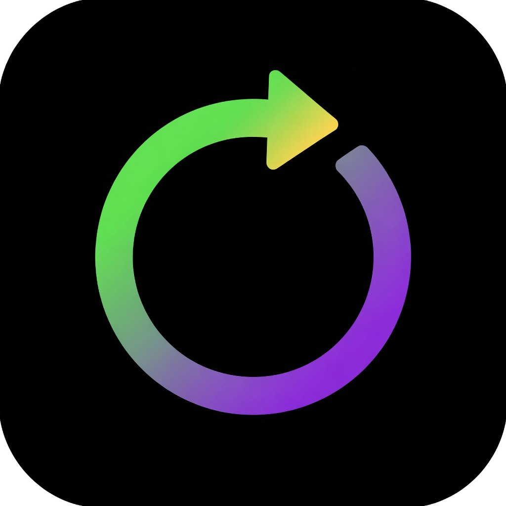
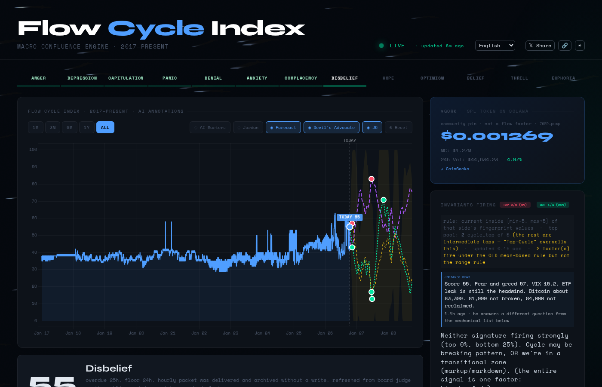

<div align="center">



# Flow Cycle Index

**Live crypto market cycle dashboard with a graded track record of every call.**

[](https://theflowcycle.com)
[](https://theflowcycle.com)
[](https://theflowcycle.com)

### [→ Open the live dashboard](https://theflowcycle.com)

</div>

[](https://theflowcycle.com)

## What it does

Flow Cycle Index reads where the crypto market sits in its emotional cycle and turns that into a single 0–100 cycle score for **Bitcoin (BTC), Ethereum (ETH) and Solana (SOL)**, with history back to 2017.

- **The 13 emotional phases.** The score maps onto the market's recurring crowd-psychology loop: Disbelief, Hope, Optimism, Belief, Thrill, Euphoria, Complacency, Anxiety, Denial, Panic, Capitulation, Anger and Depression. Each phase links to historical examples on the chart.
- **Blow-off top detector.** Six signatures are scored together: parabolic move, magnitude, retail mania, macro alignment, mania breadth, and shape match against past tops. The strict detector fires only when several line up at once, the kind of setup seen at the December 2017 and November 2021 tops.
- **7-day price projection.** A day-by-day path for BTC, ETH and SOL over the next week, built from historical analogs and each coin's beta to Bitcoin.
- **Pattern match against history.** Shows how closely today's market resembles past cycle tops and bottoms.
- **Macro and on-chain context.** Fear & Greed, funding rates, open interest, spot ETF flows, stablecoin supply, MVRV, Fed net liquidity, the dollar index, yields and more, all in one view.

## How it's built

```
 feeders ──► data ──► 3 SI brains ──► consensus ──► Jordan ──► data/*.json ──► theflowcycle.com
 (market, derivs,      (analyst,       (agree /       (headline,
  on-chain/ETF,         narrative,      disagree)      thesis, calls)
  macro/sentiment)      judge)
```

### Feeders
Feeder bots collect market, derivatives, on-chain and ETF flow, and macro and sentiment data on a schedule. If a source fails, the gap is logged in `data/data_gaps.json` and nothing is filled with made-up numbers.

### The three SI brains
Every sweep runs three brains, each with its own job:

| Brain | Job |
|---|---|
| **Analyst** | Factor analysis, phase classification, falsification checklist |
| **Narrative** | Writes the plain-language read of the market |
| **Judge** | Weighs the other two and returns the consensus verdict |

Each brain runs on Grok first. If that call fails, it drops to a local model (Qwen3 via Ollama), and if that fails too, a fixed rule-based fallback takes over. A sweep never stalls on one provider. Agreement and disagreement between the brains are published in `brain_consensus.json` and `brain_disagreement.json`, and each brain's forward record is graded in `brain_forward_record.json`.

### Jordan on top
Jordan, the operator agent, reads the consensus, the mechanical model, and the history, then writes the headline, the thesis, and the directional calls. His calls go on the same graded record as the mechanical model (`mechanical_vs_jordan.json`), so you can see whether the editor beats the math.

## Receipts

Every directional call is **timestamped when it's made and graded afterwards** against what the market actually did, over a fixed window. Hits and misses stay on the record, and revisions get graded too, so nothing is quietly edited. Separate scoreboards compare the mechanical model with Jordan's calls and track 7-day price-target accuracy.

See the current hit rate and every recent call in the **Track Record** section of the [live dashboard](https://theflowcycle.com).

## The data is public

The engine is private. The output is public: every number on the dashboard is a plain JSON file in `data/`, refreshed each sweep. Read it, chart it, cite it.

| File | What's in it |
|---|---|
| `current_state.json` | Live cycle score and phase for each coin |
| `cycle_position.json` | Where each coin sits on the 13-phase loop |
| `track_record.json` | Every graded call, hits and misses |
| `price_projection.json` | 7-day projected path for BTC, ETH and SOL |
| `blowoff_tracker.json` | Blow-off top detector state and signatures |
| `brain_consensus.json` | What the three brains agreed on this sweep |
| `brain_disagreement.json` | Where the brains split |
| `jordan_headline.json` | Jordan's latest headline |
| `jordan_thesis.json` | Jordan's current thesis |
| `mechanical_vs_jordan.json` | Model vs Jordan scoreboard |
| `etf_flows.json` | Spot ETF flows |
| `onchain.json` | On-chain metrics |
| `macro.json` | Macro context (liquidity, DXY, yields) |
| `data_gaps.json` | Sources that failed in the latest sweep |

Raw URL pattern: `https://raw.githubusercontent.com/BadmonLano/flow-cycle/main/data/<file>.json`

## Features

- **Auto-updates** about every 70 minutes, no manual refresh needed
- **10 languages**, detected from the browser and switchable from the header
- **Installable app**: add it to your home screen or desktop like a native app
- **Light and dark themes**, with your choice remembered
- **Share to X**: one click posts the latest market headline with a link to the dashboard

## License

Copyright (c) 2026 Bentayga Empire LLC. All rights reserved.
The data may be viewed and cited with attribution to [theflowcycle.com](https://theflowcycle.com). The code and engine are proprietary. See [LICENSE](LICENSE).

## Links

- [Live dashboard](https://theflowcycle.com)
- [About Flow Cycle Index](https://theflowcycle.com/about/)
- X: [@JOSYSTEMS](https://x.com/JOSYSTEMS) · [@BadmonLano](https://x.com/BadmonLano)
- GitHub: [BadmonLano](https://github.com/BadmonLano)

---

<div align="center">© 2026 Bentayga Empire LLC</div>
